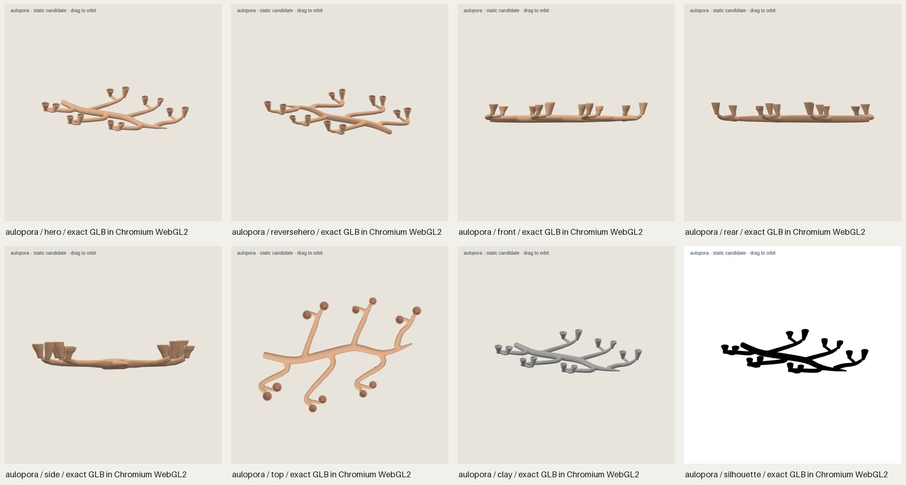
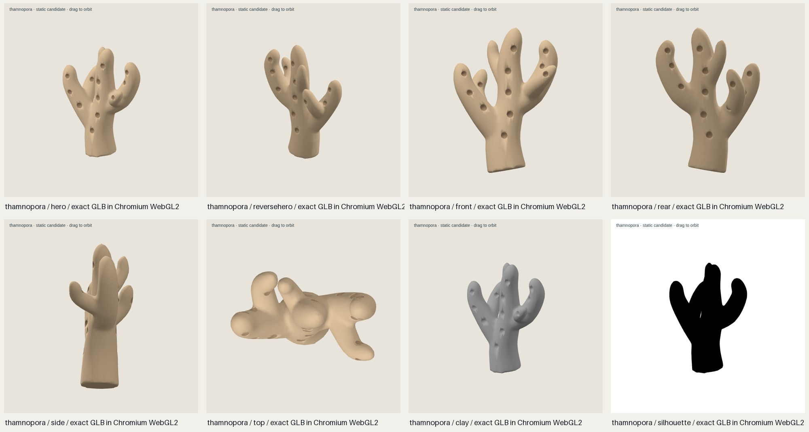
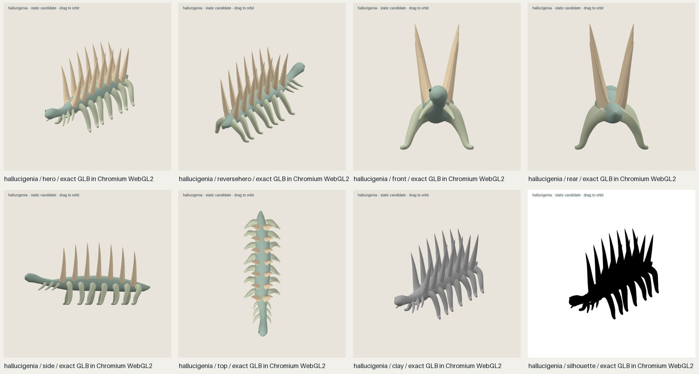
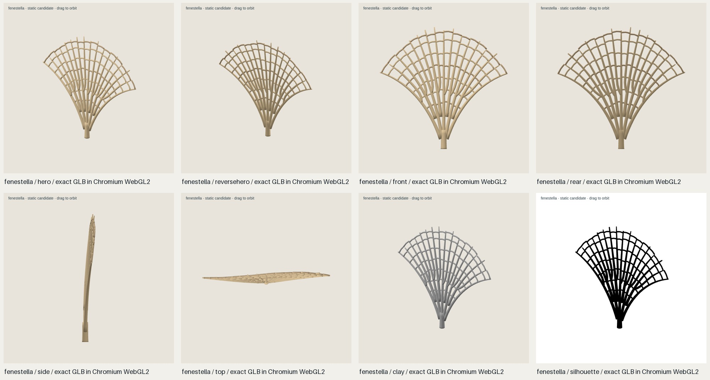

# 独立 QA 审查：small-life batch-06

**审查分支：** `qa/s010s/lowpoly-vault-candidate/small-life-batch-06-20261018`

**被审候选：** `e82f82ea41221afecc140d2fc7056e87cf6c1bc6`

**审查人：** Leon Made This <8357465+s010s@users.noreply.github.com>
**范围：** 按本批认可的自然、精致、风格化低模方向评审基本形体；不要求严格物种复原或微观细节。

## 结论

四个 **模型级视觉、源文件/GLB 一致性和独立 GLB 浏览器运行检查均 PASS**；没有发现必须返工的模型缺陷。面向使用者的标签仍应写作 stylized-inspired，不能宣称这些模型是严格科考复原。

**正式 candidate gate 仍未通过。** 四条现存 candidate 记录均为 `valid=false`、`approved_for_brief=false`，审核阶段为 unknown，批准仍 pending。独立报告不修改 candidate 记录，绝不把 checker 的失败记成 PASS。跨批次的确切放行问题见下文“Candidate checker”。

## 文件及证据绑定

交付索引和其引用的源文件、GLB、配置、brief、generator 与 references 共 24 个文件已重新计算 SHA-256 和字节数，全部与 `delivery-index.json` 一致。完整逐项记录及 handoff/index 哈希在 [artifact-integrity.json](source-export/artifact-integrity.json)。四个 GLB 与 Blend 的 SHA-256 都同时绑定在下表与独立运行/源导出 JSON 中。

我用 Blender 4.3.2 在不保存源文件的情况下逐件重开 Blend，并重新运行 `scripts/check_source_export.py`。四件的源和 GLB 三角面数一致，轴变换后的边界框最大误差均为 **0 m**。工具回报 `pass_with_warnings` 是因为模型有 smooth faces；我逐件看过真实 GLB 的颜色、clay、silhouette 和六个方向，平滑的分叉、触手以及杯口都与批次接受的风格相符。Aulopora 的开口杯腔和珊瑚分支孔口是设计空腔，并非偶失面。

对四份原始 GLB 又运行 Khronos glTF Validator 2.0.0-dev.3.10：每件 **0 errors、0 warnings**。独立 Chromium/Three.js 0.180.0 WebGL2 加载完全相同哈希的 GLB，并渲染 8 个固定视角及 top-view 80/160/240 px 预览；没有加载错误、console error 或失败请求。此环境为 ANGLE/Vulkan SwiftShader 软件渲染，不能据此声称真实显卡性能或博物馆设备兼容性。

## 逐件判定

表中边界尺寸为浏览器读取到的 GLB 坐标轴包围盒 X×Y×Z，转换为毫米；`sourceSHA` 是源 Blend SHA-256，`GLBSHA` 是确切审查的 GLB SHA-256。

| 项目 | 源 Blend SHA-256 | GLB SHA-256 | GLB 尺寸 (mm) / 三角面 | 模型级判定与必须修复 |
|---|---|---|---|---|
| **Aulopora r001** | `8e046d1b5f68e29c6e8a8e60fa808bf2d1652f7ab4f135a486ba391a863581bd` | `c652b3dec0eb541bee597922251933af32c301cb2cb8a9eba5744c66ffaa5657` | 150.0×18.9×106.1 / 9,474 | **PASS；无模型必修项。** 低矮蔓延的分枝管网与向上的杯状开口可辨识；实际开口保留通畅，交接比例柔和。 |
| **Thamnopora r001** | `2deb8a9b12d50703ec1699fb4fa8f58d20243b39503526cf5a64475797cb99ae` | `35e1e2d644be711752340b2f4b7270ca600cc39de91b418d54ae35c6fcc33c20` | 143.2×200.0×88.2 / 8,866 | **PASS；无模型必修项。** 粗壮指状分枝、外向孔口及自然融合的枝叉在 hero、反向、侧/顶、clay 和 silhouette 视图中均成立。 |
| **Hallucigenia r001** | `0b0f2b2d74dfe5d06b566edc0c5e1ae5056d2ec82d835c1e4d1933d7ebadd794` | `c076974098f45795fcebc3519832cf6a3b23fa45d649f1eadedeee16c6b378f1` | 11.7×19.9×40.0 / 10,304 | **PASS；无模型必修项。** 长躯干前后方向清楚，背棘朝上成对排列，柔软弯腿连在腹侧；没有明显脱离或穿插。 |
| **Fenestella r001** | `ecd56d0ffd1679210ef58526b0ff91108ea2279e6ab4e56293fb40f061f4f56f` | `57429dfbc0381244208a38626b38d6ced591b71f16504db85c97444793d0b3f5` | 157.4×150.0×15.9 / 10,976 | **PASS；无模型必修项。** 扇形肋条和横条形成明确的真实开窗；薄侧视与正/反面均保持可读，没有意外缺面。 |

这些判定对应源文件、GLB 哈希分别为每件绑定的 [source/export 报告](source-export/)、[运行报告](runtime/) 和 [渲染视图](runtime/)。打开以下独立多视图可直接检查：

## 真实尺寸与场景尺度

四件独立模型的 top-view 80/160/240 px 实际渲染见[尺寸对照图](runtime/scale-comparison.png)：单件缩小到 80 px 时，杯口/分枝、珊瑚孔口、Hallucigenia 脊棘与开窗网格仍能辨认。三模型是约 14–20 cm 的展示尺度；Hallucigenia 长 4 cm。ROM 页面列出的 Hallucigenia 最大长度为 30 mm，故本候选在展示尺度上长 10 mm（约 33%）；当前 brief 是风格化启发模型，不要求严格 specimen-scale，这不是本轮必修返工，但若标签将尺寸说成真实最大标本，需改标签或单独说明。

12 实例中性场景的 GLB 加载和渲染通过，报告为 37 draw calls、118,862 个三角面（含地板）；[hero](runtime/scene-hero.png) 和 [top](runtime/scene-top.png) 是真实运行截图。4 cm 的 Hallucigenia 在 15–20 cm 珊瑚旁显得很小，这是实际尺寸差造成的；若未来要做四类并列展示，可把它放在前景或单独标注放大展示。这里不要求放大 canonical asset，也不把场景预览误报为 museum integration 测试。

## Candidate checker：真实缺陷与兼容性问题

实际重跑 `scripts/validate_candidate.py`，四件全部以相同第一错误结束：`brief: publication authority must remain separate`。源简报中的 `publication_authority` 是一段声称用户已授权 QA 后批量 push/merge 的文字，而检查器要求字段值严格为 `separate`。这是实际的批次权限/brief 字段缺陷；本次授权仅覆盖 push 独立审查分支，不能把 brief 的概括性文字解读为 merge 授权。应修订并重新冻结该权限字段。

接着我只在内存中模拟更正这个字段，**没有更改任何简报、记录、模型或阈值**。旧检查器继续要求 `turntable_frames >= 2`；再临时设为 2 后，它要求生产视图 `front/rear/left/right/top/bottom/clay/wire/detail`。四份冻结 brief 实际明示当前认可的是 `hero/reversehero/front/side/rear/top/clay/silhouette` 八个固定视角、0 帧 turntable，并写明“不做 production turntable campaign”。这部分是旧 validator 与当前固定八视图简报契约不匹配，不能据此判模型缺陷；但也没有据此伪造 checker PASS。

**正式放行的准确前置项：** 纠正四份 frozen brief 中过宽的 publication authority 文本；随后由工作流负责人决定将 validator 升级为识别本批已批准的固定八视图 profile，或另行批准证据契约。保持 checker 当前失败/blocked，不篡改候选阈值或模型，也不声明已批准。

诊断文件见 [candidate-checker](candidate-checker/)，其中 [compatibility probe](candidate-checker/compatibility-probe.json) 明确标注为纯内存诊断、并非通过结果。引用范围限于源简报声明的基本外形：Digital Atlas 展示 Aulopora 附生于 Favosites、Thamnopora 枝体；ROM 记载 Hallucigenia 朝向与背棘/腹足；Digital Atlas 将 Fenestella 归于 Fenestrida。它们不支持对低模进行属级微观细节审核：[Tabulate corals](https://www.digitalatlasofancientlife.org/vc/cnidaria/anthozoa/tabulata/)、[ROM: Hallucigenia](https://burgess-shale.rom.on.ca/fossils/hallucigenia-sparsa/)、[Digital Atlas: Bryozoa](https://www.digitalatlasofancientlife.org/learn/bryozoa/)。

**本审查只新增独立证据；模型、阈值、CI 权限和 candidate 记录均未更改。**
