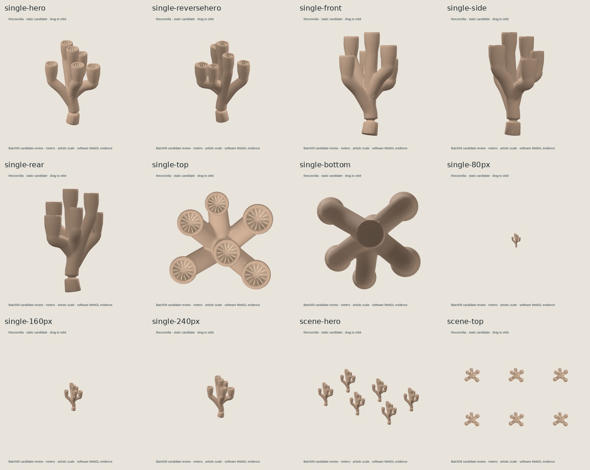
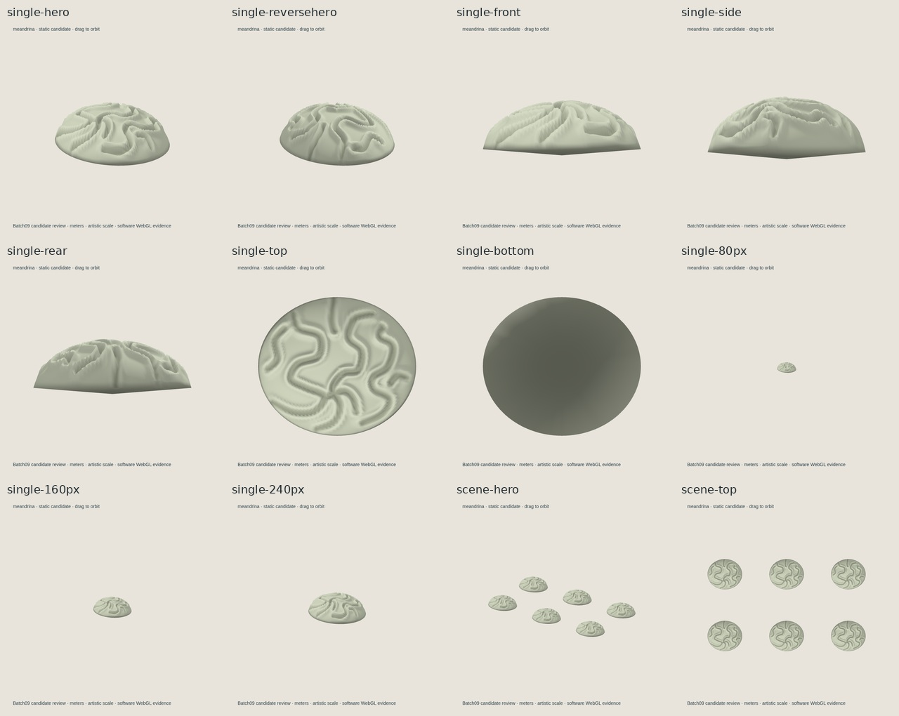
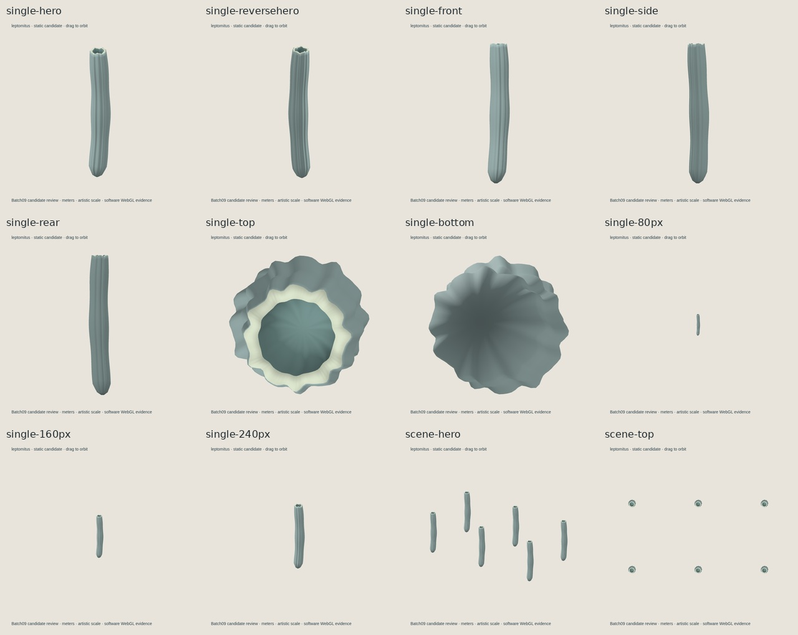
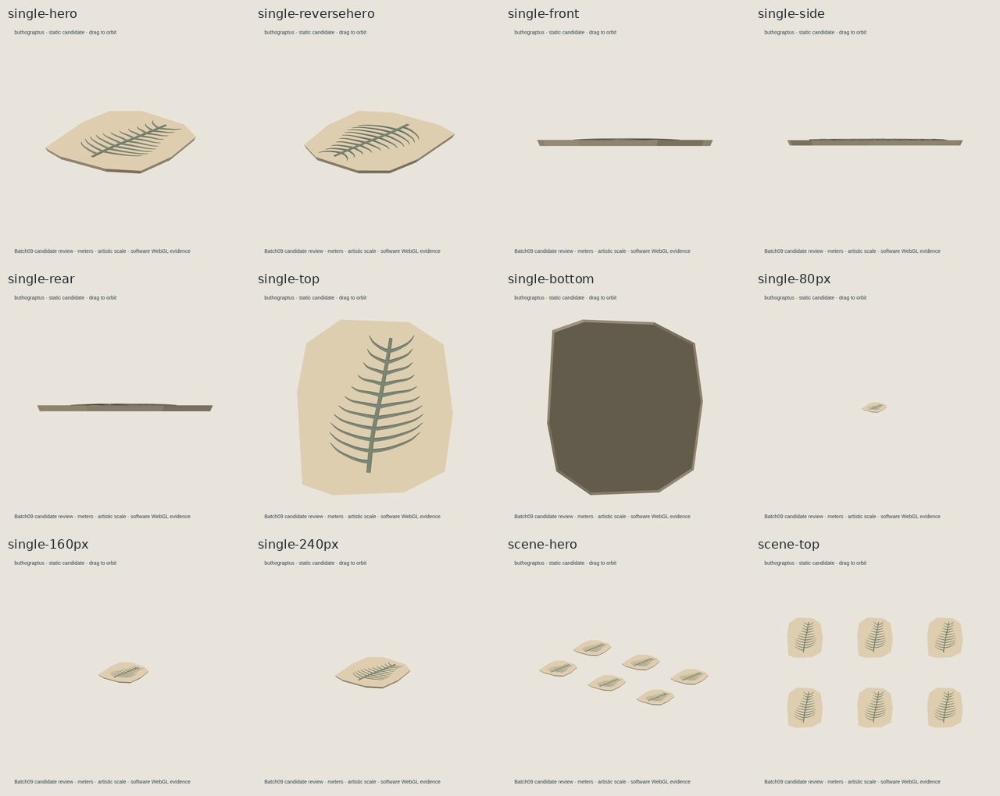

# batch-09 独立 QA 报告

审查候选提交：18af552039cc1573d676601a531ae4c2728cbabb  
隔离 worktree：/workspace/lowpoly-vault-batch09  
审查分支：qa/s010s/lowpoly-vault-candidate/small-life-batch-09-20261018  
审查范围：用户认可的自然、精致、风格化低模；检查基本识别形体、比例、连接、缺面/穿插、实际 GLB 视图及场景尺度。不要求严格科考复原或微观返工。Buthograptus 仅按保存的藻体片段审查。

## 判定

四件模型的独立外观、源文件/GLB 一致性、GLB 格式和浏览器运行均 **PASS；没有模型必修项**。该结论限定在本批风格化教学资产范围内，不是严格属/种鉴定，也不代表正式 candidate gate 已通过。

四条 legacy candidate checker 记录仍为 invalid / not approved。此报告没有把 checker 失败记成 PASS，也没有改模型、阈值或 candidate 记录。当前观察到的真实 gate 缺项与旧 profile 不匹配，详见下文。

## 哈希绑定的逐件判定

### Thecosmilia r001 — PASS，无模型必修项

- sourceSHA：473f8184b305d72fd989ba46082ba274f80815b776fbf570917b690ae48ca379
- GLBSHA：5b396b9e0385ba85eb28b028fa4291f6f98485b4ad162cedfb2632ee4f222150
- 9,488 triangles；GLB 尺寸 X×Y×Z 为 114.0×200.1×107.4 mm。
- 多视角中粗管分枝与分离深杯清楚，杯内隔壁可见；主要枝叉融合柔和，未见缺面或意外穿插。底端短平截面/轻微基部外展在 hero/front 可见，但属于连续主体的落地基部，不是脱离的部件或破面，不构成必修项。

### Meandrina r001 — PASS，无模型必修项

- sourceSHA：7797199fcfba6b4b02170282f2309b702de29fa8e63d5a2fc8f7f4dd196b79aa
- GLBSHA：2a17fa8ddcab195ebc714a377ddc487110f790762b33d59480fbb5266509077c
- 10,240 triangles；尺寸为 180.0×62.9×158.0 mm。
- 低圆丘、连续迷宫沟谷与成对隆起壁在 top 和斜视中均可读，识别主要由几何起伏承担，原始 256×256 纹理只作轻微色彩辅助（50,300 encoded bytes，262,144 decoded RGBA bytes，低于本轮上限）。底面平整符合丘体接触面；未见意外缺面或沟壁穿插。

### Leptomitus r001 — PASS，无模型必修项

- sourceSHA：a654fba96e01f8acc9a624a80a71e1472adeb544e12a92992a8aa1485ae0be27
- GLBSHA：9c13db9350fce9cbecf827dcf6cbfbac12aec7bba884dc2bdf608f24c69071e6
- 8,832 triangles；尺寸为 31.5×201.2×31.1 mm。
- 纤长管体、克制纵褶、开口顶缘及圆钝基部清楚；反向、侧向、顶/底视未见非预期穿孔、缺面或零件脱开。该简化符合风格化尺度，不作 spicule 细节数量复原声明。

### Buthograptus r001 — PASS，无模型必修项

- sourceSHA：a6592a81b6e917b061b35b3f30583c6295abfe859740f0bf1a5f23fd4eb3860f
- GLBSHA：66f4381bd47cbec25dbf8d2da46c413365677b4a9ec480ff3b920857ad484881
- 7,168 triangles；尺寸为 118.0×5.2×133.0 mm。
- 仅呈现浅浮雕保存藻体片段：中央轴和逐渐收尖的侧枝在 top/斜视可读；front/side 很薄是本片段范围的预期表现。原始教学托片不是完整生物，也未添加根、holdfast 或全株推断。未见意外缺面或穿插。

## 独立技术与运行证据

- **身份与文件哈希：** 重新计算 HANDOFF.json 中 45 个带 SHA/字节数的条目，零不匹配；另核对 HANDOFF.md/JSON 本身。完整逐项记录见 [artifact-integrity.json](source-export/artifact-integrity.json)。
- **Blend 重开与源导出：** Blender 4.3.2，禁用自动脚本执行，不保存源文件。四件三角数与 GLB 相同；轴转换包围盒最大误差分别为 Thecosmilia 1.63×10⁻⁹ m、Meandrina 0 m、Leptomitus 0 m、Buthograptus 2.33×10⁻¹⁰ m。新复核 JSON 在 [source-export/recheck-20261018](source-export/recheck-20261018)。只有 intentional smooth-shading 人工审阅提示；多视角已看过并接受。
- **Khronos：** 对上述四个精确 GLB 重跑 glTF Validator 2.0.0-dev.3.10；全部 0 errors、0 warnings、0 infos、0 hints。新报告在 [gltf-validator/recheck-20261018](gltf-validator/recheck-20261018)。
- **浏览器：** 独立 Chromium / Three.js 0.180.0 GLTFLoader 加载与截图，sourceSHA 和 GLBSHA 写入运行报告。单件为 7 个 GLB 视角（hero/reversehero/front/side/rear/top/bottom）及 80/160/240 px 预览；场景为每件 6 个实例的 hero/top。四件均无 page/console error 或失败请求。运行设备是 ANGLE SwiftShader 软件 WebGL2，不代表物理 GPU 性能。
- **场景尺度：** 各自独立的六实例场景；Thecosmilia 18 draw calls / 56,928 triangles，Meandrina 6 / 61,440，Leptomitus 18 / 52,992，Buthograptus 18 / 43,008。各场景的实例数与包围盒均使用原始米制，没有为并排观感归一化；不据此宣称 museum integration 或跨时代共存。

实际 GLB 多视角联系表：

## 形态依据与主张边界

只按 brief 的基本外形进行宽泛核对：Thecosmilia 来源页描述 phaceloid/dendroid 杯体及圆柱状 corallites；Meandrina 页面支持低丘/板状生长与连续沟谷；ROM 对 Leptomitus 记载为伸长管状海绵、纵向骨针变化形成皱褶、顶部开口及圆钝基部；LoDuca 2019 与 Earth@Home 的材料支持 Buthograptus 的藻体/分枝形态，但本候选仅表示保存片段，不推断完整植株。来源分别见 [Corallosphere](https://www.corallosphere.org/taxon/1517.html)、[Corals of the World](https://www.coralsoftheworld.org/species_factsheets/species_factsheet_summary/meandrina-meandrites/)、[Royal Ontario Museum](https://burgess-shale.rom.on.ca/fossils/leptomitus-lineatus/)、[LoDuca 2019](https://commons.emich.edu/fac_sch2019/78/) 和 [Earth@Home](https://earthathome.org/hoe/mw/fossils-cl)。没有复制来源网格、图片或贴图；Buthograptus 图注用于形态范围，但其原图像素不作为本审查证据。

## Legacy candidate checker：真实缺项与 profile 不匹配

我对四条现存 candidate 记录重新运行 scripts/validate_candidate.py。实际结果全部为 valid=false、approved_for_brief=false，首个错误分别是：

- Thecosmilia / Meandrina：IV-PRI-SCLERACTINIA.license: nonempty text required
- Leptomitus：IV-ROM-LEPTOMITUS.license: nonempty text required
- Buthograptus：FL-ordovician-algae.license: nonempty text required

这是**真实的引用元数据字段缺项**，不能作为 checker PASS。对应 references.json 将来源标记为 consulted-only，并声明没有纳入第三方媒体、网格或贴图；因此该失败本身不证明发生了未经授权的内容复制，也不是模型几何问题。Buthograptus 还有第二条 consulted-only 来源没有 license 字段。候选放行前应由工作流负责人决定如何如实表示“仅咨询文本、未纳入来源媒体”的 license/rights 状态，并更新相关哈希/记录；本审查不改动这些冻结输入。

此外，对 validator 源码与冻结 brief 的静态对照发现：旧 validator 要求 publication_authority 精确为 separate、turntable_frames 至少 2、并要求另一套 9 个 production views；本批 brief 明确为父级批次授权、turntable_frames=0、8 个固定视图。这是 brief/checker profile 契约不一致，不能用来否定模型外观，也不能靠本报告略过首个真实 license 字段失败。具体运行结果和契约对照见 [candidate-checker](candidate-checker/)。完整证据文件哈希/字节数清单见 [evidence-manifest.json](evidence-manifest.json)。

本报告只评模型，不代替父任务进行 candidate 记录接受或发布。四条 candidate 记录仍保持 pending/unknown；父任务协调流程 gate 与发布。本轮没有改模型、阈值、CI、权限或其他批次，也没有 merge 或 Drive 操作。
