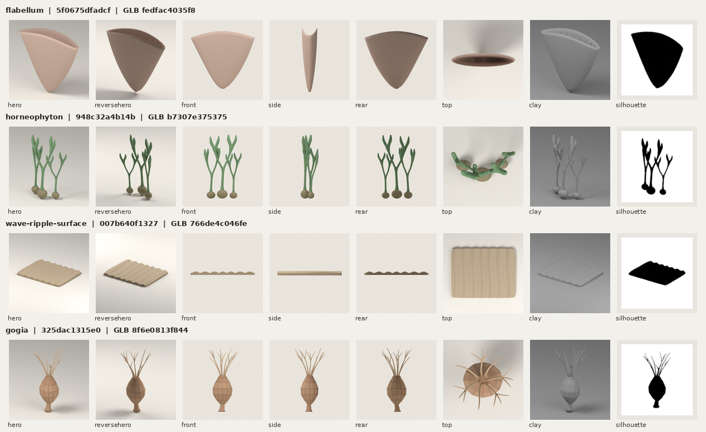
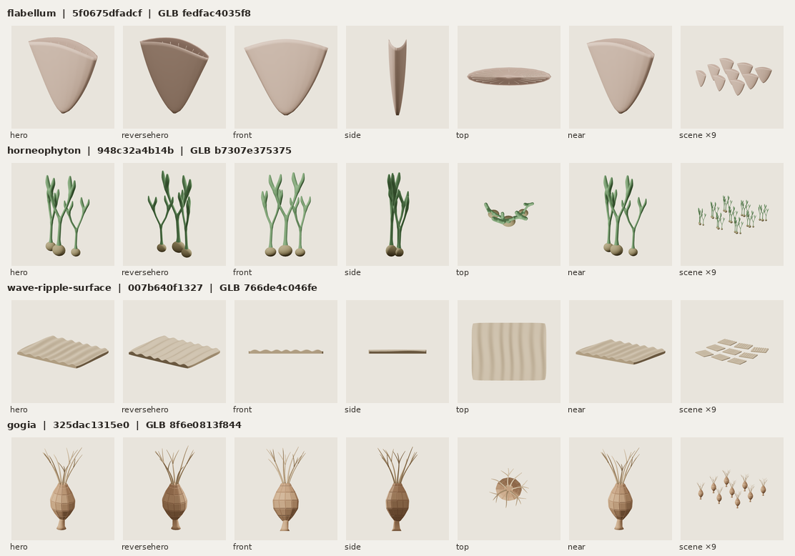
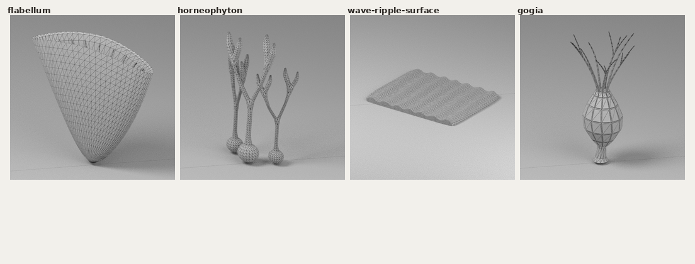

# Batch-10 independent QA — GPT-6 Luna xhigh

Review date: 2026-10-18 UTC  
Review branch: qa/s010s/small-life-batch10-20261018  
Review base / exact handoff source: cce0de6c86f8bcbb061930bae4026b7c1a28f1e2  
Handoff JSONL SHA-256: 5f80524afcbcd7d0d8b18f168cd43290c7e83ed88430b9bfb719041ca5849d63  
Profile: static-stylized-v1 / rule 2026-10-18.1

## Overall result

**Independent model QA: PASS for all four exact candidates.** The silhouettes and joins read well in the fixed views, exact-GLB runtime images, 9-copy scene, and near views. No model repair is required.

This does not make the candidate records fully approved. The old legacy validator still returns FAIL for each exact record because its original source-reference entry has no license text. The static profile contract returns pass and record validity true, while approval remains false and `--require-approved` still exits 1 because candidate stage attestations remain unknown/pending. Those outcomes are preserved separately below; no license was invented and no candidate record was rewritten.

| Asset | Exact candidate commit | GLB bytes / triangles | GLB SHA-256 | Blend SHA-256 | Independent model QA | Legacy-v1 |
|---|---|---:|---|---|---|---|
| flabellum | 5f0675dfadcfaa7dbeb202966bc21e155ba923d4 | 77,384 / 3,966 | fedfac4035f835b425b3d66f3b56e3977d7c0c0ddde69229e324024c8e9a5c69 | c6fdacba0aecbc193c18932b61ec2808456041bd0edd95114832f2b3d31d18e4 | PASS | FAIL — IV-PRI-SCLERACTINIA.license |
| horneophyton | 948c32a4b14b8f8a495100096c32e2c46f91b2a1 | 120,172 / 6,444 | b7307e375375e1d63fe03ee3d14baa94d7b85aa3238fae3753d30a4f8237b20b | 96e8eaf2a5960187c99f8e5ece75c37868f41594d01349497363da4806350f49 | PASS | FAIL — FL-rhynie.license |
| wave-ripple-surface | 007b640f1327a8650626a0c25cb1e654b92da93e | 117,640 / 5,328 | 766de4c046febf7e29667fde27eee9345522ef0b4e011e0828605996ce0491a7 | 8b9b17588f488e697fcee2808545743daac0c74c3b6c0c759d899079bf16e811 | PASS | FAIL — EN-SE.license |
| gogia | 325dac1315e0578b98f9ecaeffae04f7d18d9086 | 87,560 / 3,144 | 8f6e0813f844d32b21ba919f4bc7316fe92cd0f0d05d47c4330544d8f0690591 | 4e3c2a42bfa67c757c78ab055243e2f0d03341ffa2bc40c7f1928ab4dd10be9c | PASS | FAIL — IV-ECHINODERM-FORMS.license |

The exact source branch tips match the pinned handoff commits. All changed paths in each maker commit stay within that candidate’s asset and batch work directories. The GLB/Blend/brief/reference/generator/config and evidence hashes match the handoff. No shared validator, threshold, CI, permission, or earlier-batch file changed.

## Profile and record-gate verification

I read `docs/candidate-profile-compatibility.zh-CN.md` before review. The review checkout is pinned to the handoff source commit. At review time origin/main was 0bd62cda92814af5ac781e1a706bba6310cecc35; its compatibility doc, `validate_candidate.py`, `candidate_profile.py`, and publication policy are byte-identical to this checkout. The profile rule is 2026-10-18.1.

For each exact candidate, I regenerated `profile-contract.json` using the checked-in `candidate_profile.py`; each generated SHA matches the maker’s pinned profile-contract SHA. The explicit static-profile invocation reports `profile_contract_status: pass`, `valid: true`, and `errors: []`. The nested `legacy_result` remains `valid: false` with the exact license error listed above. A separate default legacy invocation returns the same error. `--require-approved` exits 1 for each because approval and required stage attestations are still pending. Raw validator results are in [validation-results.json](validation-results.json).

The candidate’s derived reference records use exactly `consulted-only`, set `incorporated: false`, retain a nonempty `rights_note`, and state `no_incorporated_third_party_assets: true`. The static profile accepts that contract. I did not infer a third-party license or convert the legacy failure to a pass.

## Visual, factual, scale, and runtime review

The eight fixed view names are exactly hero, reversehero, front, side, rear, top, clay, and silhouette. All eight images are hash-verified against their manifests and all manifests pin the exact candidate GLB SHA. `turntable_frames` is 0 throughout; “side” remains “side.” The runtime image manifests, reports, and screenshots also pin the same exact GLB bytes.

| Asset | Independent shape and craft result | Intended scale / runtime result | Factual scope check |
|---|---|---|---|
| **flabellum** | **PASS.** The side-compressed solitary cup widens into a clear blade-like opening; the hero/reversehero/front and top views preserve its wedge silhouette and useful internal septal rhythm. Side thinness is the requested form, not a broken edge. | Nominal 0.09 m art scale is labeled as such. The 9-copy scene and 480px-supported near view stay readable; no visible rim gaps beyond the intended open cup. | A consulted-only teaching-art analogy is appropriate: the Digital Atlas documents solitary Flabellum forms and named examples, while the candidate avoids an exact species or fossil-dimension claim. ([Digital Atlas of Ancient Life](https://www.digitalatlasofancientlife.org/learn/cnidaria/anthozoa/scleractinia/)) |
| **horneophyton** | **PASS.** Three upright, forked shoots rise from visible swollen corm-like bases; the rounded terminal forks read as continuous sporangial branches. The few stem crossings remain natural and readable in near view. It does not read as marine flora. | Nominal 0.15 m shoot-cluster scale is labeled. The 9-copy scene keeps branches legible at intended size; the near view shows continuous junctions, not detached tips. | Kerp’s Rhynie-chert review describes the terrestrial context and captions Horneophyton’s bulbous rhizome with basal upright axes. This is consistent with the simplified candidate claim; no tissue or spore microstructure is claimed. ([PubMed record for Kerp 2018](https://pubmed.ncbi.nlm.nih.gov/29254960/)) |
| **wave-ripple-surface** | **PASS.** The bounded shallow patch reads as symmetric rounded wave ripples, with a visible cut edge. Relief is regular enough to read clearly but the authored spacing has gentle variation; no unearned seamless-tiling or locality claim is made. | Nominal 1.5 m patch width is an art-direction scale. The shallow profile is intentional; it reads in front/side/top and at scene size rather than relying on a close crop. | The BGS memoir distinguishes symmetric wave ripples from current ripples and treats them as a shallow-water sedimentary structure. The asset remains a generic process prop, not a named locality. ([British Geological Survey memoir](https://webapps.bgs.ac.uk/Memoirs/docs/B01602.html)) |
| **gogia** | **PASS.** A short attachment stalk supports a pear-shaped plated theca and a fine branching crown. The low-poly plate rhythm remains visible at normal and near views; the simplified crown does not imply an exact brachiole count. | Nominal 0.10 m height is labeled. The 9-copy scene remains distinguishable; the near view preserves the crown-to-theca connection. | The Royal Ontario Museum’s Gogia stephenensis description supports a rounded conical theca, short stalk, interlocking plates, and straight near-apical brachioles that may branch. The candidate’s simplified count is within its stated scope. ([Royal Ontario Museum — Burgess Shale fossil gallery](https://burgess-shale.rom.on.ca/fossils/gogia-stephenensis/)) |

The maker’s runtime images are 512×512 screenshots from Chromium 154 / Three r180 / ANGLE SwiftShader software WebGL. All views in the reports have `gl_error: 0`; each exact GLB loads and renders. The GPU is disclosed as software rendering, so these observations support functional loading/rendering only, not physical-device or production-performance claims. I checked both the 9-copy scene and the close view for every asset; at intended scene scale the main forms remain recognizable.

### Technical cross-check

- The independent `qa_glb.py` audit passed on all four exact GLBs with no errors or warnings. I used its defaults (12,000 triangles, 8 materials, 24 primitives); all candidates are below those caps and below their own brief ceilings. The brief has no minimum GLB byte size: 77,384 B and 87,560 B are not defects.
- A fresh Blender 4.3.2 GLB import compared converted bounds and triangle counts against the Blender source. All four had 0.0 m maximum bounds error, identical triangle counts, and no roundtrip errors. The maker’s source-export and two semantic rebuild reports record pass; my independent check here is the fresh importer comparison above, not a rerun of the deterministic build.
- The fresh import audit emitted aggregate boundary-edge warnings for Flabellum (128), wave-ripple-surface (1,288), and Gogia (1,464); Horneophyton had none. Those raw warnings are retained in [roundtrip/](roundtrip/). The audit does not localize those edges or establish a missing face. I inspected the imported wireframes and shaded runtime views: the boundaries correspond visually to the open Flabellum rim and split/interfacing surface geometry; I saw no uncovered hole or broken silhouette. This is a non-blocking render-use note, not a request for a topology repair. If these assets are later repurposed for fabrication or manifold operations, that would need a separate topology review.

No photo-reference pixel comparison was possible or claimed by the maker for several inherited source entries. The reference ledgers are explicit about textual access limits. This review checked the narrowly stated basic forms against accessible institutional/paper text and the rendered results; it does not require strict specimen reconstruction, precise anatomy counts, or microscopic detail.

## Per-item decisions

- **flabellum — PASS** for independent visual, technical, scope, and runtime review. **Required record issue:** old legacy validator remains invalid for the empty source-license text. **Non-blocking suggestion:** none.
- **horneophyton — PASS** for independent visual, technical, scope, and runtime review. **Required record issue:** old legacy validator remains invalid for the empty source-license text. **Non-blocking suggestion:** none.
- **wave-ripple-surface — PASS** for independent visual, technical, scope, and runtime review. **Required record issue:** old legacy validator remains invalid for the empty source-license text. **Non-blocking suggestion:** none.
- **gogia — PASS** for independent visual, technical, scope, and runtime review. **Required record issue:** old legacy validator remains invalid for the empty source-license text. **Non-blocking suggestion:** none.

These PASS decisions are independent QA observations for the exact source/asset hashes above. They do not edit candidate stage records, approve the formal candidate record, authorize publication, merge main, or release the models.

## Contact sheets

The fixed-eight sheet and runtime sheet below are derived from individual images whose hashes were independently matched to their manifests. Exact-GLB Blender reimport wireframes are included for the boundary-edge review.







## Reproducible commands

The following were run against the detached exact-source snapshots using the validator code whose four relevant files match current origin/main. For one asset, substitute its exact directory from the table/handoff JSONL.

```sh
ASSET=flabellum
SRC=/tmp/batch10-source-$ASSET
CAND=assets/candidates/continuous-small-life-round04-20261018/batch-10/$ASSET/r001
mkdir -p "$SRC/qa-independent-run"
python /tmp/batch10-qa/scripts/candidate_profile.py "$CAND/candidate.json" --root "$SRC" > "$SRC/qa-independent-run/profile-contract.json"
python /tmp/batch10-qa/scripts/validate_candidate.py "$CAND/candidate.json" --root "$SRC" --profile static-stylized-v1 --profile-contract "$SRC/qa-independent-run/profile-contract.json" --json
python /tmp/batch10-qa/scripts/validate_candidate.py "$CAND/candidate.json" --root "$SRC" --json
python /tmp/batch10-qa/scripts/validate_candidate.py "$CAND/candidate.json" --root "$SRC" --profile static-stylized-v1 --profile-contract "$SRC/qa-independent-run/profile-contract.json" --require-approved --json
python /tmp/batch10-qa/scripts/qa_glb.py "$SRC/$CAND/$ASSET.glb" --report /tmp/b10-checks/$ASSET-qa-glb.json
blender -b --factory-startup --threads 2 --python-exit-code 1 --python /tmp/batch10-qa/scripts/check_glb_roundtrip.py -- "$SRC/$CAND/$ASSET.glb" --output-dir /tmp/b10-checks/roundtrip/$ASSET --no-render
```

For the rendered roundtrip wireframe evidence, I repeated the Blender command without `--no-render`, with `--samples 16 --resolution 512`, and directed output to `/tmp/b10-checks/roundtrip-render/$ASSET`.

## Evidence files

- [evidence-recheck.json](evidence-recheck.json) — exact source/GLB/Blend pins, view/runtime image hash checks, scene metrics, and independent GLB/Blender audit results.
- [validation-results.json](validation-results.json) — full explicit static-profile, default legacy, and require-approved JSON outputs for all four candidates.
- [fixed-eight-contact-sheet.png](fixed-eight-contact-sheet.png)
- [runtime-contact-sheet.png](runtime-contact-sheet.png)
- [glb-roundtrip-wireframe-contact-sheet.png](glb-roundtrip-wireframe-contact-sheet.png)
