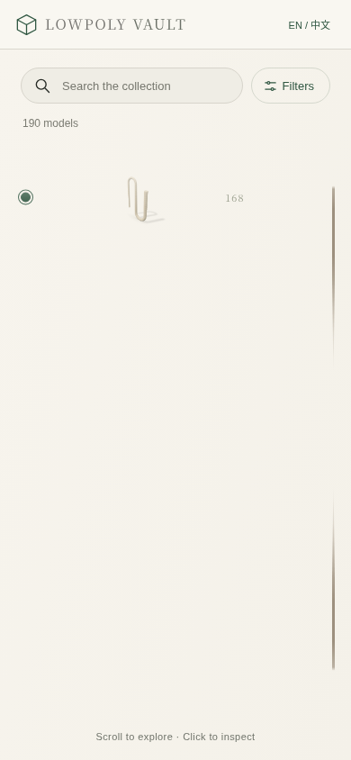
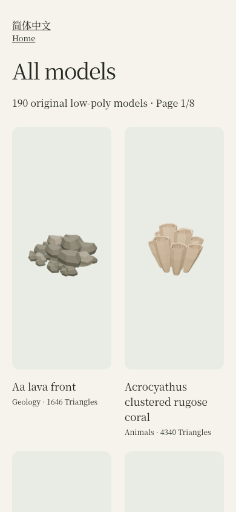

# 移动端目录独立浏览器 QA（基线）

本报告只验收基线 `0cbef7c9826ddd1d83e7d0c941b7864dbaa6865c`。尚未收到主实现的修复 branch / exact SHA，因此没有修复后验收结论，也没有合并或发布。所有提交只包含本目录内的验证代码和证据；模型、production、site 和 main 均未改动。

验证实际运行在保存的云环境 `/workspace/lowpoly-vault`。真实 Chromium 版本为 `154.0.8037.57`，由 Playwright 1.56.1 驱动。实际 WebGL renderer 为 `ANGLE (Google, Vulkan 1.3.0 (SwiftShader Device (Subzero) (0x0000C0DE)), SwiftShader driver)`，不是静态 DOM 测试。触屏尺寸为 390×844 和 320×844，桌面尺寸为 1440×1000；这些是 Linux 模拟设备，不能代表物理 iOS Safari。

完整发布构建通过原有 publication-check、Vite、copy-and-package 和 full-release-audit。构建含 190 个模型、400 份双语 HTML 和 2396 个允许发布的文件。截图来自实际页面；原用户截图未下载、复制或上传。

## 结果与复现

主检查有 16 个场景、96 个断言，5 个场景通过、11 个失败；76 个断言通过、20 个失败。没有未捕获的页面运行错误。逐项结果见 [checks.md](baseline-final/checks.md)，所有实际状态、历史记录、URL、网络请求和失败详情见 [report.json](baseline-final/report.json)。报告中的 `pass` 只覆盖列出的检查；例如网络场景通过“滚动不请求 GLB”，不代表缩略图策略已经优化。

| 场景 | 结论与范围 |
| --- | --- |
| 390 移动导航 | 失败。普通返回暂时保持多行；经过历史往返并启动 3D 后，Collection 返回只剩一个可见模型。列表 URL、Collection 和浏览器历史语义均失败。 |
| 320 移动导航 | 失败。复现与 390 相同的单模型和 URL 问题，未发现横向溢出。 |
| 集合筛选与滚动 | 失败。`prehistoric-starter` 的 10 个结果、名称排序和滚动值保持；返回 URL 仍保留刚选择的模型。 |
| 直接英文详情路径及刷新 | 失败项是关闭后列表 URL 仍带默认模型。路径 `/models/natural-arch/` 与刷新本身正确呈现 Natural Arch，使用既有详情弹窗。 |
| 直接详情查询 URL 及刷新 | 失败项是 Collection 后仍留 `?model=natural-arch`。打开和刷新时的模型身份正确。 |
| 直接中文详情路径及刷新 | 失败项是关闭后列表 URL 仍带默认模型。中文详情身份与刷新正确。 |
| 五次快速打开/返回 | 失败。最终列表可见，但 URL 仍为详情模型。 |
| 移动滚动与显式交互 | 通过列出的检查。滚动与普通移动详情均无 GLB；仅按 Interact in 3D 后加载实际选中 GLB。 |
| 延迟图片、快速滚动 | 通过功能检查。滚动未请求 GLB，列表仍可用；大量图片请求及并发问题记录如下。 |
| 桌面 hover、选择及历史 | 通过。90ms hover 不请求 GLB；有意 hover 请求真实模型，离开时取消待完成请求；长 hover 和显式选择正确，单 renderer，Back/Forward 选择正确。 |
| 移动待完成 GLB 后返回 | 失败。返回后 GLB 未取消，仍完成下载；该序列也返回单模型列表。 |
| 桌面快速待完成选择 | 通过。旧 GLB 被取消，最终模型、首帧和选择身份一致，只有一个 renderer。 |
| 隐藏目录更新后返回 | 失败。详情内切换语言触发隐藏列表更新；返回的最初五个 rAF 帧仅有一个模型，约 100ms 后恢复，恢复的具体事件来源未单独定位。 |
| 延迟入口 JS | 失败。真实首屏为旧的 24 项静态网格，再切换为新版目录；链接内容与后续增强可用。 |
| 延迟新版 CSS | 失败。单独延迟包含 `.slot-image` 的 gallery CSS 同样出现旧静态网格，恢复后新版可用。 |
| 无 JS fallback | 通过。真实链接到详情、下载链接存在、浏览器 Back 返回列表，移动端无横向溢出。补充检查实际点击 GLB 下载并确认下载成功。 |

稳定复现单模型的方法是：在 390 或 320 页面打开列表，滚动约 1400px，点中央 Diplomoceras，按 Collection，尝试浏览器 Forward，再次点开列表模型，执行浏览器 Back/Forward，按 Interact in 3D，等真实 WebGL 首帧后再按 Collection。两种宽度的返回状态都保留 190 个结果，但 `#slots` padding 为 `0px`，`#wheel.scrollTop` 为 `21376`，可见项仅为 `diplomoceras`。



该画面不是目录筛选只剩一个结果。`measure()` 在隐藏时读取到零高度、隐藏期间重建虚拟行，以及返回后不主动重测的路径，与实际 DOM 状态一致。`galleryURL()` 总是写入 selected model；Collection 调用 `replaceState`，没有真实回到列表历史项。对应基线源码为 [main.js 第 66 行](https://github.com/s010s/lowpoly-vault/blob/0cbef7c9826ddd1d83e7d0c941b7864dbaa6865c/site/gallery/main.js#L66)、[main.js 第 191 行](https://github.com/s010s/lowpoly-vault/blob/0cbef7c9826ddd1d83e7d0c941b7864dbaa6865c/site/gallery/main.js#L191) 和 [catalog-source.js 第 33 行](https://github.com/s010s/lowpoly-vault/blob/0cbef7c9826ddd1d83e7d0c941b7864dbaa6865c/site/gallery/catalog-source.js#L33)。



## 图片与 GLB 请求

[network-summary.json](baseline-final/network-summary.json) 分开统计 `-wheel.png` 缩略图、canonical detail poster、SSG/其他图片和 GLB；原始逐笔记录含阶段、完成/取消、状态码、响应体大小和耗时。并发是浏览器同时挂起的请求数量，不是 HTTP socket 数量。

普通移动浏览序列的首屏发起 39 次图片请求：20 个 wheel thumbnail、8 个 detail poster 和 11 个 SSG/其他图片请求。首屏完成的图片响应体合计约 4.32 MB。短暂停留 70ms 后累计变为 49 次图片请求；18 次快速滚动后累计为 97 次。此时 GLB 请求一直为 0。只有显式 3D 交互后才有 1 次 GLB 请求。

500ms 图片延迟场景累计请求 96 张图片，最高同时挂起 37 个图片请求，GLB 为 0。快速滚动阶段的 27 个新 wheel thumbnails 全部完成，没有因离开视口取消；detail poster 有 23 次取消，仍有 8 次完成。因此当前预热并非完全不取消，但 wheel 缩略图和 detail poster 不应混为一类。

移动端启动一个刻意延迟 1400ms 的 GLB 后约 90ms 返回列表，GLB 仍以 200 状态完整下载 `132448` 字节，未触发取消。桌面 pending hover 离开后被 `net::ERR_ABORTED` 取消；桌面快速切换也取消旧选择，瞬间最多 2 个挂起 GLB 请求，最后选中项身份正确。

截图中的正常桌面 hover 与移动显式交互仍实际工作。修复后应重复这些检查，不能仅以“请求数更少”判定通过。

## 可复跑的证据

主报告、截图、网络汇总、构建日志和来源哈希均在 [baseline-final](baseline-final/)。实际无 JS 原生下载检查另见 [baseline-nojs-download/report.json](baseline-nojs-download/report.json)。[browser-environment.json](baseline-final/browser-environment.json) 记录实际 renderer；[source-integrity.json](baseline-final/source-integrity.json) 确认应用与模型路径没有改动。

在待验收的 exact application SHA 上完成同样的发布构建后，使用以下命令运行保留的检查脚本。`QA_SOURCE_SHA` 必须填写真正构建的 SHA，不能仅填一个标签或未经确认的主分支头。

```sh
SITE_BASE=/lowpoly-vault/ SITE_ORIGIN=https://s010s.github.io npm run build
QA_LABEL=after-exact-sha QA_SOURCE_SHA=<exact-built-sha> node qa/independent/mobile-list-20261020/run-browser-qa.mjs
```

`QA_FILTER` 可只重跑一个场景；完整修复验收应运行全部场景。原生路径详情与 gallery 查询详情都已被脚本识别，不会将既有详情弹窗误报为 gallery 启动超时。

## 工具问题与未验证范围

启动环境第一次报 `exec-server connection attempt failed: timed out waiting for exec-server initialize handshake after 10s`，后续恢复。第一次 npm 安装因 `/home/agent/.npm/_cacache` 不存在失败，改用允许写入的 `/tmp/lowpoly-qa-npm-cache` 后安装成功。探测 `/root/.cache/ms-playwright` 时收到 Permission denied；未重试该路径，使用已经可用的 `/usr/bin/chromium`。

真实浏览器访问 `https://s010s.github.io/lowpoly-vault/models/` 返回 `net::ERR_TUNNEL_CONNECTION_FAILED`。因此本次只验证 exact SHA 的本地发布产物，线上浏览器验证尚未完成；没有通过关闭代理或其他方式绕过访问限制。

早期检查脚本错误地只等待 gallery，导致两次 native path 详情检查超时；已识别为检查脚本问题，修正后重跑全部最终场景并确认详情身份正确。早期延迟所有 stylesheet 的试验导致 Playwright screenshot 10 秒超时，随后一次原生 capture 也未返回，该旧试验进程已停止；最终改为单独延迟新版 gallery stylesheet，真实截图成功。早期未完整执行的输出不作为验收结果。

物理 Safari/Android、实际用户设备、生产 CDN 时序、断网后的离线可用性、长时间内存压力、模型艺术质量以及尚未提供的修复 exact head 均未验收。主实现任务负责修复，本任务没有重复实现，也没有改 main。
